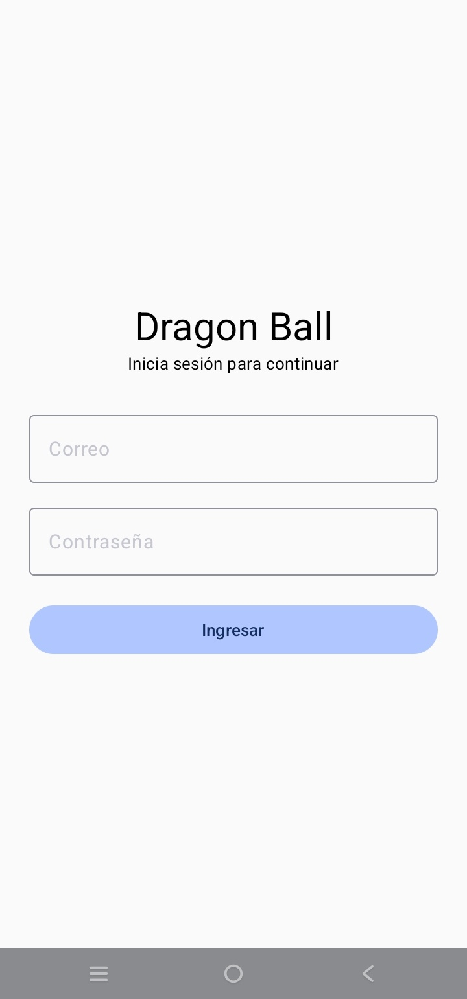
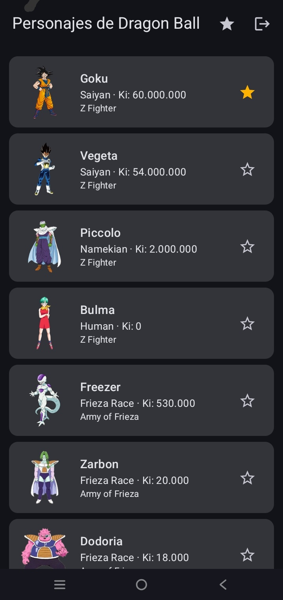
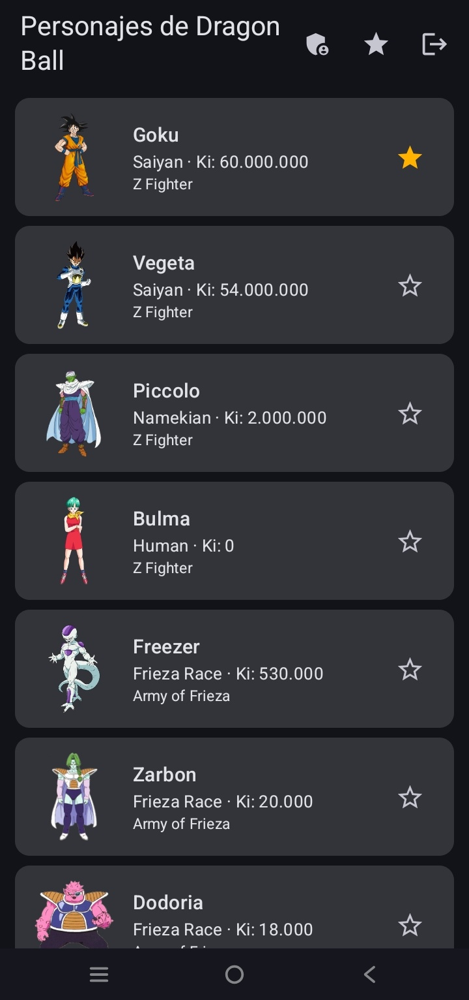
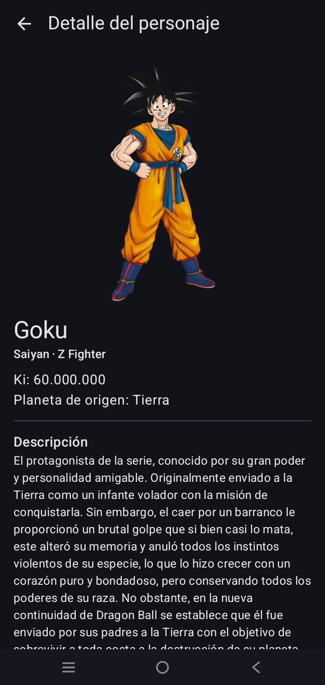
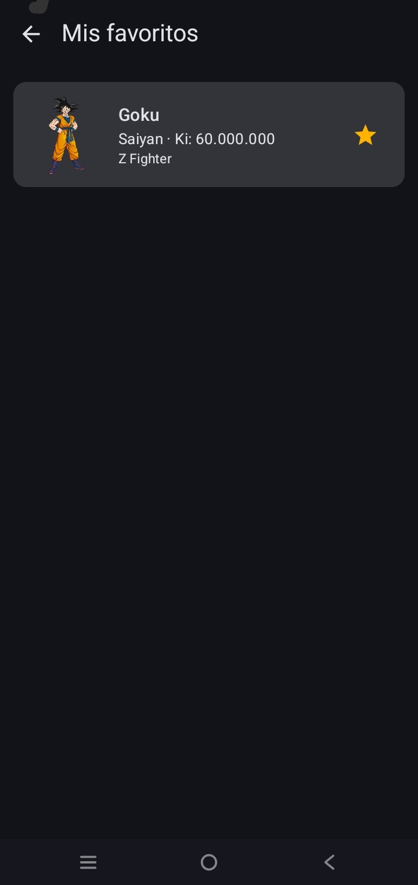
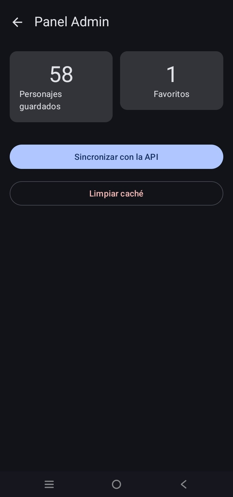
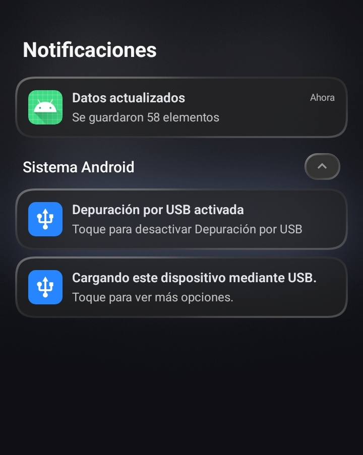

# Dragon Ball – Catálogo de personajes

Aplicación Android en **Kotlin + Jetpack Compose** que muestra el catálogo de personajes de Dragon Ball.
Tiene login con dos roles, datos descargados de internet, favoritos guardados en el celular, modo sin conexión,
panel de administración y notificación local.

Laboratorio 11-12 · Programación en Móviles · TECSUP

| | |
|---|---|
| **Integrante** | José Rojas Condor |
| **Modalidad** | Individual (autorizado por el docente) |
| **Tema** | Dragon Ball (tema libre) |
| **API** | [dragonball-api.com](https://dragonball-api.com) (pública, sin clave) |
| **Paquete** | `com.rojas.dragonball` |

---

## Endpoints usados

| Uso | Método | Endpoint |
|---|---|---|
| Lista de personajes | GET | `https://dragonball-api.com/api/characters?limit=58` |
| Detalle de un personaje | GET | `https://dragonball-api.com/api/characters/{id}` |

La lista viene envuelta en `{ "items": [...] }` y el detalle agrega el planeta de origen y las transformaciones.

---

## Funcionalidades

- **Login** con correo y contraseña (Firebase Authentication). Valida campos vacíos y muestra el error si las credenciales fallan.
- **Dos roles** (`admin` y `usuario`) leídos desde Firestore (`usuarios/{uid}`). El rol decide si se ve el panel Admin.
- **Lista** de personajes con estados Cargando, Error (con botón Reintentar) y Vacío.
- **Detalle** del personaje con el segundo endpoint: planeta de origen, descripción y transformaciones.
- **Room** como fuente única de verdad: la lista siempre sale de la base de datos del celular y Retrofit solo la actualiza.
- **Favoritos** con estrella en cada tarjeta y pantalla *Mis favoritos*. Se conservan al cerrar la app y al sincronizar.
- **Modo sin conexión**: sin internet se muestra lo guardado con un aviso y botón Reintentar. El detalle muestra los datos básicos guardados.
- **Panel Admin**: total de personajes guardados, total de favoritos, botón Sincronizar y botón Limpiar caché.
- **Notificación local** «Se guardaron N elementos» al terminar de sincronizar, con canal y permiso `POST_NOTIFICATIONS`. Al tocarla se abre la app.
- **Sesión** que se mantiene al reabrir la app y botón Cerrar sesión.

---

## Arquitectura (MVVM)

```
Pantalla (Compose)  →  ViewModel (StateFlow<UiState>)  →  Repository (interface)  →  Room / Retrofit / Firebase
```

```
app/src/main/java/com/rojas/dragonball/
├── MainActivity.kt
├── AppContainer.kt              ← crea la API, la base de datos y los repositorios
├── data/
│   ├── remote/                  ← ApiService, RetrofitClient, dto/ItemDto
│   ├── local/                   ← ItemEntity, ItemDao, AppDatabase (Room)
│   ├── auth/                    ← AuthRepository (interface) y FirebaseAuthRepository
│   ├── repository/              ← ItemRepository (interface) e ItemRepositoryImpl
│   └── mapper/Mappers.kt        ← ItemDto → ItemEntity → Item
├── domain/model/                ← Item, Sesion + enum Rol
├── notification/                ← Notificador (interface) y NotificadorAndroid
└── ui/
    ├── navigation/AppNav.kt
    ├── UiState.kt
    ├── login/ · lista/ · detalle/ · favoritos/ · admin/
    ├── components/              ← Cargando, ErrorView, AvisoSinConexion
    └── theme/
```

- Las pantallas solo observan el estado con `collectAsStateWithLifecycle()` y llaman funciones del ViewModel.
- El ViewModel depende de las interfaces `ItemRepository` y `Notificador`, nunca de clases concretas ni de `Context`.
- Cada ViewModel se crea con un `ViewModelProvider.Factory` que recibe el `AppContainer`.
- Tres modelos separados: `ItemDto` (API), `ItemEntity` (Room) e `Item` (UI).

---

## Tecnologías

Kotlin · Jetpack Compose · Material 3 · Navigation Compose · Retrofit + Kotlinx Serialization · OkHttp ·
Room (KSP) · Firebase Authentication · Cloud Firestore · Coil · Coroutines + StateFlow

---

## Cómo compilar

1. Clonar el repositorio y abrirlo en Android Studio.
2. Crear un proyecto en [Firebase](https://console.firebase.google.com/) y registrar una app Android con el paquete `com.rojas.dragonball`.
3. Descargar `google-services.json` y colocarlo dentro de la carpeta `app/` (no está en el repositorio porque contiene la clave de API).
4. Hacer **Sync Now** y luego **Run** en un emulador con Google Play o un celular con Android 7.0 o superior.

---

## Cómo crear los usuarios de prueba

1. **Authentication → Método de acceso**: habilitar *Correo electrónico/contraseña*.
2. **Authentication → Usuarios**: crear dos usuarios (uno admin y uno usuario) y copiar el **UID** de cada uno.
3. **Firestore Database**: crear la colección `usuarios` con un documento por usuario.
   El **ID del documento es el UID** y tiene los campos:

   | Campo | Tipo | Valor |
   |---|---|---|
   | `rol` | string | `admin` o `usuario` |
   | `nombre` | string | nombre a mostrar |

4. **Firestore → Reglas**: pegar y publicar:

```
rules_version = '2';
service cloud.firestore {
  match /databases/{database}/documents {
    match /usuarios/{uid} {
      allow read: if request.auth != null && request.auth.uid == uid;
      allow write: if false;
    }
  }
}
```

> Las credenciales de los usuarios de prueba se entregan al docente por el aula virtual, no se guardan en el repositorio.

---

## Capturas

| Login | Lista (usuario) | Lista (admin) |
|---|---|---|
|  |  |  |

| Detalle | Favoritos | Panel Admin |
|---|---|---|
|  |  |  |

| Notificación |
|---|
|  |

---

## Reparto de tareas

Trabajo individual: José Rojas Condor desarrolló todas las capas de la aplicación
(interfaz, ViewModels, Retrofit, Room, Firebase y notificaciones), la configuración de Firebase y la documentación.

---

## Ramas y versión

- `main`: Fase 1, la aplicación completa.
- `mejora-ia`: Fase 2, mejoras con IA, pruebas unitarias y `PROMPTS.md`.
- Versión `v1.0` con el APK de depuración adjunto.
